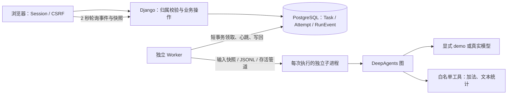

# V0.2 架构：可靠任务执行

## 目标与边界

把“网页保存一个需求”推进到“后台可靠执行并交付结果”。本版是单 Agent 任务执行底座，不宣称已有多 Agent 派工、人工审批恢复或本地设备连接。这些分别在 V0.3/V0.4 交付。



浏览器不是执行所有者，关闭页面不会停止 Worker。Worker 可以与 Web 分别启动、关闭、重启。执行图不能批准业务任务状态，也不能直接写数据库。

## 数据为什么分三层

- **Task**：用户想完成什么、归属谁、当前业务状态。
- **Attempt**：某一次尝试；冻结标题和需求、模式、凭证、进程身份、心跳、结果和错误。失败后新建 Attempt，不覆盖原历史。
- **RunEvent**：本次执行的有序展示事件；模型调用、工具开始/结束、领取、终态。它不是 checkpoint，也不作为模型输入重复提交。

本版不持久化 LangGraph checkpoint，所以中断后不能从模型调用中途续跑。重试是重新执行，这点与故障恢复显示状态必须分清。

## 状态与一致性

```text
待启动 → 排队 → 运行 → 成功 / 失败 / 取消 / 中断
          └→ 取消
失败 / 取消 / 中断 → 显式重试 → 新 Attempt 排队
```

中断分为“旧进程尚未确认停止”和“已确认停止”。前者占据任务归属和全局额度，阻止重试；后者允许用户显式发起新 Attempt。成功任务不能直接重复启动。

Task 与 Attempt 终态、对应事件在同一事务写入。所有同时操作两表的路径先锁 Task 再锁 Attempt，降低锁顺序不一致造成死锁的风险。Heartbeat 仅更新单表。

## PostgreSQL 领取为什么这样做

启动先锁 Task，检查同任务 request_key 是否已存在；有则返回原 Attempt，没有才创建。数据库额外约束“每任务一个活动执行”，保护其他写入路径。

Worker 领取用 `select_for_update(skip_locked=True)`，锁住一项排队 Task，再锁对应 Attempt。事务只做领取，不持有锁等待模型。

单靠行锁不能限制多个 Worker 的总并发：两个 Worker 可能各自看到额度空闲。故领取前使用同一个 PostgreSQL **事务级 advisory lock** 串行完成“统计全局占用 + 领取”；出事务自动释放。全局最多 2；每 Worker 默认 1，可设置 1 或 2。

不用 Redis/Celery 是当前规模的取舍：先维持一个持久化事实来源，避免新增 broker、投递确认和数据库双写。未来需要更大规模时，可以替换分发机制，Task/Attempt 和幂等、凭证协议仍需保留。

## 取消、租约与旧进程

领取生成 UUID token；事件和结果写回必须匹配 token 和运行状态。心跳租约为 20 秒，监督循环约 0.2 秒轮询。过期心跳不能复活租约，过期结果不能转成成功。

取消分两类：排队时直接终止，运行时先设置取消请求，由 Worker terminate → 等待 → 必要时 kill → wait，再写取消终态。最终结果与取消竞争时，通过行锁决定先后：取消已提交则结果不采用；成功已提交则取消为幂等无操作。

子进程 stdin 是存活通道：Worker 死亡，操作系统关闭管道，子进程监控线程退出整个进程，即使模型请求正阻塞。启动时先登记 PID 和进程创建时间，再发送任务输入，避免未登记进程开始模型工作。

恢复不只看 PID：同主机核对 PID + create_time；启动登记间隙按子进程命令中的执行凭证扫描。不同主机或权限不足时不声称已确认停止。没有权限覆盖按钮；应在原主机恢复 Worker 或人工排查，不以盲目重试逃避确认。

## 安全与诚实边界

每个入口先验证任务 owner，再查 Attempt；事件同样受保护。状态与 owner 不接收浏览器赋值；POST 保留 CSRF。

业务 Agent 只向模型暴露工具白名单，实际调用再检查一次。DeepAgents 原生文件、Shell 和委派工具即使被模型猜到也被拒绝。StateBackend 不挂宿主目录。子进程仅接收必要模型配置，不继承 PostgreSQL 密码、Django 密钥或旧项目供应商凭据，默认关闭 LangSmith tracing。

这不是 OS 沙箱：代码仍由当前用户的 Python 进程运行。本版只执行我们编写的无副作用工具，不提供用户代码执行或 Shell。新增有副作用工具前，必须设计授权和防重复执行协议。

本系统没有“恰好一次外部副作用”保证。我们防止重复领取、隔离过期结果并禁止自动重试；后续本地工具仍需独立的操作 ID 与幂等实现。
