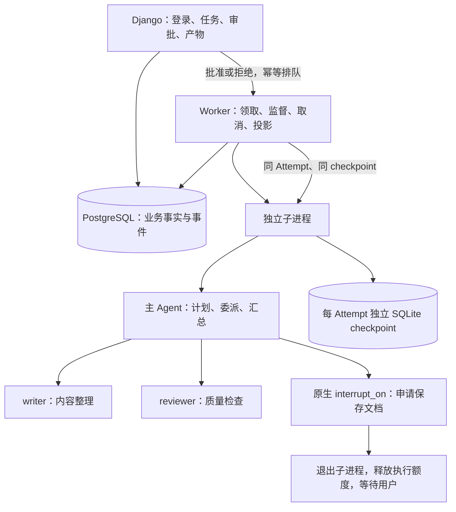

# V0.3 架构：协作、人工关卡与恢复

本版把 V0.2 的可靠单次执行扩展为多 Agent 任务协作。首批能力是整理用户材料、撰写计划、检查遗漏并交付文档，不具备搜索、设备工具、任意文件访问或 Shell。

## 分工而不是多个聊天窗口

主 Agent 负责用户目标、原生 `write_todos` 计划、调用 `task` 委派与最终交付；writer 只整理收到的文字，reviewer 只审阅收到的草稿。子 Agent 返回草稿和意见，不直接保存产物、不递归委派。主 Agent 可以根据任务需要决定是否委派，离线演示固定经过两个角色用于完整验收。

每个角色分别配置工具白名单：模型只收到允许的 schema，执行边界再检查一次。原生通用子 Agent、文件工具及 execute 即使被猜中也被拒绝。模型调用共享进程内信号量，每个 Attempt 最多一个模型请求；两个活动 Attempt 的全局额度沿用 V0.2。多角色不等于放开模型并发。

`SubTask` 是一次委派的展示/追溯投影，不是另一个可启动的业务任务。关联依据为原生 tool_call_id，运行中用 ContextVar 向子图传播父调用 ID，再记录 checkpoint namespace。最终从根图消息重建委派结果，恢复时不依赖浏览器事件缓存。

## 两种持久化各管什么

PostgreSQL 保存 Task、Attempt、RunEvent、Approval、Artifact、SubTask。SQLite checkpoint 保存图状态、消息、计划、已批准文档和 interrupt。每个 Attempt 有自己的数据库文件，路径由服务端 UUID 决定，用户不能提交路径。

SQLite 仅用于当前单主机的图状态，**业务队列仍必须 PostgreSQL**。这样不需要向 Agent 子进程传入 PostgreSQL 密码，也不为小规模系统引入 checkpoint RPC 服务。代价是运行文件必须持久化、备份，恢复必须回到原执行主机；未来多机迁移需重新设计 checkpoint 存储与最小权限。

数据库与文件不具备一个总事务。流程是：图先同步持久化 checkpoint → 子进程交付快照并退出 → Worker 确认退出后，在单个业务事务内更新审批/产物/计划与任务状态。若中间崩溃，原进程停止后，从 checkpoint 重新生成缺失投影。相同源 ID 的产物唯一且不可被不同内容覆盖。

## 审批和状态

新增 `waiting_approval`。它占据该任务的活动归属，但不占模型执行额度。此时子进程已退出、没有心跳需要续租，用户可以隔天再审批。

主 Agent 调用 `save_document` 时由原生 HITL 中断。页面显示名称和 Markdown 正文；批准后 `Command(resume=...)` 才让工具把文档写入图状态，Worker 检查对应已批准记录再发布 Artifact。拒绝通过原生工具结果反馈给模型，不发布文档。只有主 Agent 能申请该工具。

审批记录关联 interrupt ID、动作序号、工具调用 ID 和 checkpoint ID；更新检查版本。所有当前动作有决定后才排队恢复，同一决定请求重发不会重复执行。取消等待中的任务会关闭待处理审批，后续决定被拒绝。

## 恢复与重试不同

恢复保留 Attempt、输入、图状态和批准记录；重试新建 Attempt。每次重新领取都换 token，老进程不能提交迟到结果。V0.2 历史执行没有 checkpoint，只支持重试。

执行快照冻结工作流版本、源码指纹、DeepAgents/LangGraph/checkpointer 版本、模型名及接口哈希；不保存 API Key。配置或代码不兼容、checkpoint 缺失/损坏时明确拒绝，不偷偷从头调用模型。Key 可以轮换，但模型名称或接口改变需要新建 Attempt。

恢复图可能重新进入未完成节点，不能据此保证任意外部副作用恰好一次。本版工具只做无副作用计算或图内状态更新；以后设备操作还必须有独立操作幂等协议。

## 部署边界

服务器以独立 superagent 用户运行 Web/Worker，代码发布目录与 shared/runtime 分开，PostgreSQL 使用专用容器，仅监听 loopback。Agent 是普通 Python 子进程，不是 Docker 沙箱。本人通过 SSH 隧道访问，不开放公网 HTTP，不提供公开注册。默认禁用真实模型模式，未调用任何付费模型。
