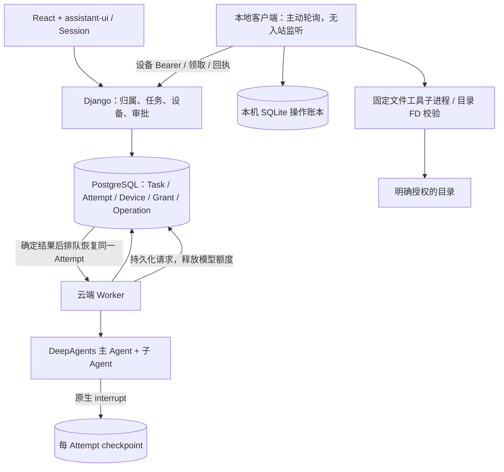

# V0.4 架构：云端编排与个人本地执行

## 与 SuperAgent Prototype 的对应关系

你对“两层”的理解基本正确，但要区分模型角色和确定性的执行基础设施。

本地参考源码 `dsh-superagent-prototype/src/app/sessions.ts` 定义主会话的 ROUTER_PRESET 与工作会话的 WORKER_PRESET，`Sessions.ensure(..., role)` 按 orchestrator/worker 创建会话。`src/core/intake.ts` 接收、去重和分发输入；Ticket、Mandate、Assignment 及执行器共同管理授权、唤醒和生命周期。不是几个模型自由抢任务，也不意味着每项工作都必须开启一个永不退出的 Agent。

我们的目标一致：前台帮助用户形成明确任务，后台异步工作，结果再交回前台。但**当前尚未实现独立长期运行的前台对话 Agent**。V0.4 的输入框是任务创建入口，不伪造一段模型需求访谈；用户确认范围并启动后，确定性的 Worker 领取任务，执行图中的主 Agent 才进行规划与委派。后续再独立加入“对话澄清 → 草稿 → 用户确认入队”的接待层，不把这个缺口藏在 UI 文案里。

| 角色 / 实体 | 负责什么 | 不负责什么 |
| --- | --- | --- |
| 网页 / 后续接待 Agent | 用户交互、需求形成、任务与审批管理 | 不直接访问用户目录，不拥有后台进程生命周期 |
| Task / Attempt / Worker | 业务事实、某次尝试、领取和监督 | Worker 不是一个负责思考的模型 |
| 主 Agent / writer / reviewer | 一次执行内部的规划、协作与交付 | 子 Agent 不是第二套业务队列的消费者 |
| 本地客户端 | 可信执行端，核对本机授权并操作文件 | 不调用模型、不接受任意 Shell、不独立决定任务 |

## 本版架构

## 设备绑定和授权

网页登录后生成 10 分钟有效的一次性高熵绑定码，客户端用它换取设备 token。绑定码和 token 在云端仅保存 SHA256；本机 token 放在 0600 配置文件，目录 0700。设备接口使用 Bearer，不接受网页登录 Session，单独关闭 CSRF；浏览器管理接口继续强制 CSRF。

目录与工具授权只在本机 CLI 创建。云端仅收到目录 UUID、别名、工具和版本，不接收绝对路径，不能替你把某个目录加进白名单。网页可以撤销，旧客户端同步不能重新启用已在云端撤销的授权；重新授权必须在本机显式操作。

每项任务选择一个授权目录，启动时冻结设备、授权版本和工具范围。离线不阻止创建任务，云端规划后需要本机能力的步骤进入 waiting_device，checkpoint 持久化，模型进程退出、释放执行额度。

## 文件与权限边界

本版支持 macOS、Linux、WSL2；原生 Windows 不支持目录 FD 安全实现，明确拒绝。工具只有 list_files、read_text、write_text：UTF-8 普通文本、64 KiB 上限；列表最多 200 项；写入只新建，不覆盖。

路径每层以目录文件描述符和 O_NOFOLLOW 打开，拒绝绝对路径、`..`、符号链接和被替换的授权根；文件读取拒绝 FIFO/设备文件。发布新文件用临时文件 + fsync + 原子不覆盖链接，避免半写文件暴露。客户端凭证目录不能被授权范围覆盖。

云端主 Agent 的 local_write_text 先走原生人工审批，批准后才建立可领取操作。子 Agent 没有本地工具权限；主 Agent 读取材料后明确委派文本。原生宿主文件、execute、未知角色仍被白名单拒绝。

这是文件工具授权，不是完整 OS 沙箱。本地客户端是用户可信执行端，不保证抵抗同一 OS 用户恶意修改客户端程序。

## 回执、未知结果与恢复

操作按 Attempt + tool_call_id 唯一，参数或授权改变时不能复用同 ID。一次只领取一个，租约 30 秒，客户端工具子进程超时 10 秒。客户端执行前把 started 写入 SQLite，执行后记录结果，再发回云端。回执丢失只重发结果，不重新操作文件。

云端状态为 pending → leased → succeeded/failed；租约过期、客户端在 started 后崩溃或任务撤销时，可能变为 uncertain。**uncertain 不自动重领、不自动续跑**。用户先检查本机结果，可取消旧任务后显式重试；新建文件不覆盖的规则进一步阻止重复写坏已有文件。

只有全部当前审批有决定、全部本地操作有确定结果，才能排队恢复图；全程使用同一个 Attempt，不把展示事件当模型输入。撤销会阻止之后的领取/开始，但无法撤回一个已经开始或已经生效的写入；迟到结果不会恢复已取消任务。

## 前端与兼容

采用 [assistant-ui/assistant-ui](https://github.com/assistant-ui/assistant-ui)（MIT）的真实 ExternalStoreRuntime、Thread、Message 和 Composer，不使用 assistant-cloud。Django 仍持有状态，模型密钥不进入浏览器。黑白灰布局包含工作台、队列、过程/审批/产物和设备页；无虚构百分比。

`/app/` 为新入口，旧简易界面和接口保留。V0.3 的 Python 图源码冻结在 workflow_v03，按执行版本选择，保留旧审批恢复能力；已核对冻结源码与原部署提交 aa75c6e 字节一致。不迁移或清空数据库。
