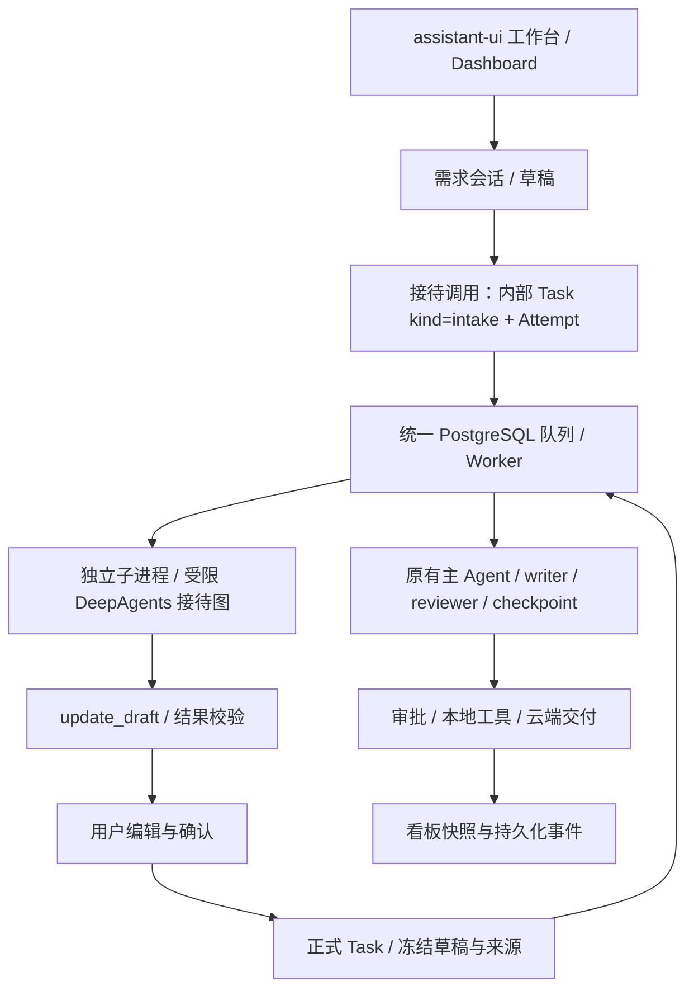

# V0.5 架构：接待、确认与后台执行

目标是用户先讨论、明确任务，再交给后台助手，而不是让聊天模型管理进程。模型负责语义判断，数据库事务负责归属、确认、版本、领取和终态。

## 为什么复用 Attempt

新增独立调度器会使接待模型和后台模型分别计数，突破服务器额度。我们把接待调用存为 kind=intake 的内部 Task，关联 Turn 和原有 Attempt；它不是正式业务任务，不进入任务列表/看板，不允许通过普通启动入口调用。两种调用共享 PostgreSQL 原子领取、全局最多二、服务器一个 Worker 执行槽、子进程存活管道、取消、超时及迟到结果隔离。

接待图是独立工厂，仅向模型暴露 update_draft，执行入口再次白名单检查。原生文件、Shell、委派和正式确认工具都不提供。子进程不持有 Django 密钥、业务数据库密码或设备 token。云端模型仍可读取用户主动输入的材料。

## 草稿与确认

Conversation 持有当前草稿和递增版本；Turn 关联输入、助手回复、Attempt 和调用时草稿版本；Confirmation 保存不可覆盖的草稿快照、来源 Turn ID 与正式 Task。归属通过 Conversation/Task owner 沿外键核验。

会话行锁防止两个消息同时入队。执行期间拒绝编辑/确认；结果在 Attempt 终态事务中投影到草稿，旧版本结果不能覆盖新内容。用户编辑携带期望版本，前端保留编辑起点版本，不能用轮询获取的新版本号覆盖旧草稿。

确认与建 Task 在同一事务。会话+版本及会话+请求键均有唯一约束，重复点击返回同一任务。问题列表非空时不允许确认；假设需要明确勾选。确认仅创建 pending 任务，用户仍需启动。已确认草稿通过继续讨论或编辑形成新版本，不改变旧 Task/Attempt 输入。

## 看板事实来源

六列是业务状态投影，不是第二套可编辑状态机。内部调用不展示成后台交付任务。待确认来自尚未确认的草稿；待启动/排队/执行/完成来自 Task；等待审批、等待设备、未知结果、失败、中断归到待处理并显示原因。取消默认不显示，通过历史筛选查看。

活动标签只引用已记录的模型角色、规划、工具、委派事件；不猜测隐藏思维链，不显示估计百分比。完整事件保存在 RunEvent，详情分页读取；首页每页三十项，每两秒校准。当前为少量个人任务，在服务端合并草稿和任务后分页；大规模时需改为数据库分页联合查询和聚合，不能宣称无限扩展。

## 模型与版本边界

项目独立 Key/模型/Base URL，安全终端通过固定主机 SSH stdin 更新私密运行配置。填入配置不等于模型可用，显式 model_check 验证两次请求：一次工具调用、一次工具结果响应。验证状态绑定配置指纹，不保存 Key。真实入队须开关开启且状态 ready，错误不回退演示。

V0.3/V0.4 图源码没有修改，原 checkpoint 继续按原版本恢复。接待调用不承诺中途 checkpoint 恢复；中断后显式发送新一轮，保留失败记录。公网 HTTPS、邀请制和配额治理仍是后续版本。
