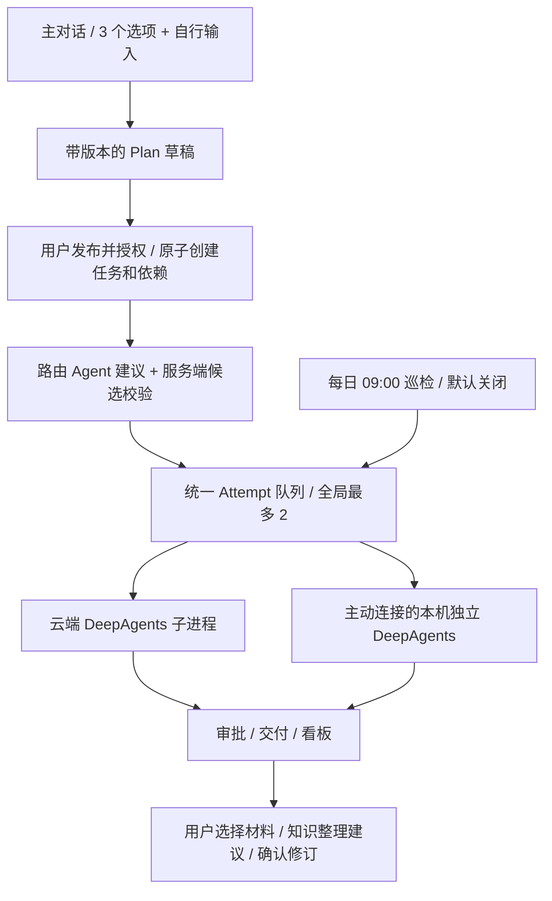

# V0.6 架构：主对话与多设备编排

## 执行边界

主对话有 ask_user、update_plan、read_tasks、query_knowledge；不能发布。ask_user 形成一条持久化问题，三个不同候选项由模型提出，自定义输入由界面统一提供；回答关联问题，并作为下一轮输入。当前知识查询只访问本轮根据用户输入匹配到的知识材料，不把全部历史会话喂给模型。

Plan 保存结构化任务、依赖、角色、工具与可选执行目标/授权目录。发布必须使用用户 Session/CSRF、草稿版本和幂等键；事务校验依赖无环、未决问题、假设、资源与工具，创建 Release 和 pending 任务。发布动作授权自动派工，不再需要逐个手动启动。新增写入仍走原生审批。

## 路由与历史职责

AgentProfile 是稳定身份，记录 owner、角色、云端或设备、授权目录、工具、模型模式和版本清单。它不是另一个任务队列。路由是受限 DeepAgents Job，候选由服务器按权限与资源筛选，当前需求会话里的历史负责人优先，再检查可用性。模型只能在当前候选内选择。派工前再次检查，设备/权限失效不能沿用旧建议。

指定设备离线时等待，不能自动转移。Agent 模型配置和目录版本冻结进 Attempt，工具权限只取 Plan 与本地授权交集。相关历史摘要及前置任务交付传入本轮，附 Task ID，不复用别的任务 checkpoint，不混入其他会话。

默认并发全局 2、服务器 Worker 1、每设备 1。云端和设备领取共享 PostgreSQL advisory lock，云端不领取 execution_device 非空的 Attempt。路由调用也占用全局模型额度，其调用数从正式工作任务的模型请求限额中扣除。

## 本机执行协议

旧客户端 run 继续服务云端图的文件请求；agent-run 是独立本机工作执行器，Key 只留本机。两者使用不同运行锁和执行协议，agent-run 不覆盖旧客户端 session。Agent 子进程只收到模型/工具配置和授权数据，没有设备 Bearer、业务数据库密码或 Django 密钥。

每次执行使用本机独立 checkpoint 和 budget.sqlite3。权限快照不含 token，固定文件工具执行前重新核对本机授权；目录 FD、O_NOFOLLOW、新建不覆盖规则保留。模型调用、生图和 MCP 额度在副作用前持久化扣减，审批恢复不重置。

父进程登记 started、PID 和进程创建时间后才发送输入；子进程监听父管道。事件进入 SQLite outbox 后发送，云端按领取凭证摘要和事件游标去重。结果先落盘再上传图片/提交回执；重连只重报，不重放图。父进程异常退出、结果不明时标记中断，云端不凭本机 PID 宣称进程停止。人工确认入口如实记录为用户确认，不冒称独立验证。

## 工具和知识

搜索、生图、MCP 均使用独立配置。角色仅看到允许的工具 schema，实际调用再次检查。MCP 只加载配置中的服务与工具白名单，非模型传入的任意 URL；云端只支持 HTTPS HTTP transport，本机另可运行固定 stdio 配置。MCP 工具默认都经过审批，不能把 annotations 当安全承诺。

图片保存于 Attempt 私有目录，实际 PNG 格式/大小验证后才登记产物；读取和下载检查 owner。设备图片来源注明为设备回传。

知识 Source 保存不可变原始文本；Proposal 是模型建议；Page/Revision/WikiLog 保存用户确认后的规范页、来源、索引与追加日志。没有云同步、向量库或新沙箱。模型分析不能替代人对事实正确性的判断。

巡检默认关闭，用户启用后按账号时区每天 09:00 之后运行一次，不补跑旧日期，每次最多 8 个模型请求。只有站内建议，不创建新的开发任务、不自动扩大权限、不直接批准知识修改。
